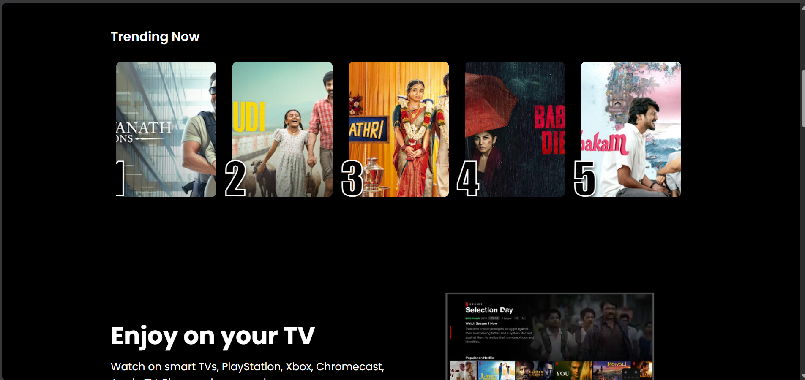

# 🎬 Netflix India Clone

A responsive Netflix India landing page clone built using **HTML5 and CSS3**. This project recreates the look and feel of Netflix's homepage with a dark theme, trending titles, feature sections, and an FAQ section.

<p align="center">
  
  
  
</p>

## 📸 Screenshots



## ✨ Features

- 🎥 Netflix-inspired homepage design
- 📱 Responsive layout for different screen sizes
- 🔥 Trending titles displayed as poster cards
- 📺 Feature sections highlighting Netflix-style content
- ❓ Interactive FAQ section using HTML `<details>` and `<summary>`
- 🎨 Dark background with Netflix-inspired red accents
- ↔️ Horizontally scrollable trending section
- 🧩 Clean HTML and CSS structure

## 🛠️ Tech Stack

- **HTML5** — Website structure and content
- **CSS3** — Styling, layout, animations, and responsiveness
- **Git and GitHub** — Version control and project hosting

## 📂 Project Structure

```text
NetflixClone/
├── index.html
├── style.css
├── README.md
├── bg.jpg
└── logo.svg
```

## 🚀 Getting Started

Follow these steps to run the project locally.

### 1. Clone the repository

```bash
git clone https://github.com/prakhar-117/NetflixClone.git
```

### 2. Open the project folder

```bash
cd NetflixClone
```

### 3. Run the website

Open `index.html` in your browser.

Alternatively, open the project in Visual Studio Code and use the **Live Server** extension.

## 💡 What I Learned

While building this project, I practised:

- Structuring web pages using semantic HTML
- Styling layouts with CSS Flexbox and positioning
- Creating responsive designs using media queries
- Using CSS overflow and scroll snapping for horizontal scrolling
- Building an FAQ section without JavaScript
- Organizing project files and documenting code on GitHub

## 🔮 Future Improvements

- Add JavaScript-based interactions
- Improve responsiveness across more screen sizes
- Add a functional language selector and sign-in interface
- Enhance accessibility and keyboard navigation
- Deploy the project using GitHub Pages

## ⚠️ Disclaimer

This is an educational frontend project inspired by Netflix's website. It is **not affiliated with, endorsed by, or connected to Netflix**. Netflix branding and related assets belong to their respective owners.

## 👨‍💻 Author

**Prakhar Varshney**

- GitHub: [@prakhar-117](https://github.com/prakhar-117)
- Repository: [NetflixClone](https://github.com/prakhar-117/NetflixClone)
- LinkedIn: [Prakhar Varshney](https://www.linkedin.com/in/prakhar-varshney-17pv07)

---

<p align="center">Made with ❤️ and lots of CSS</p>
